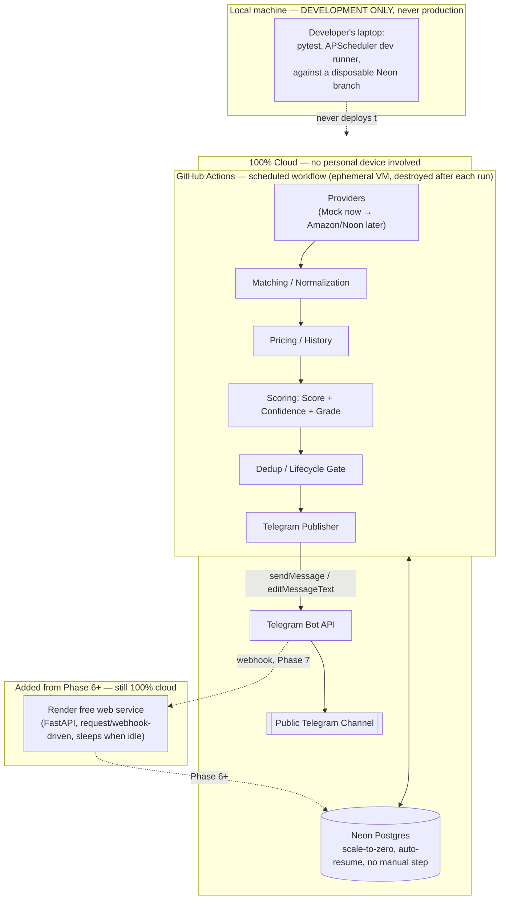
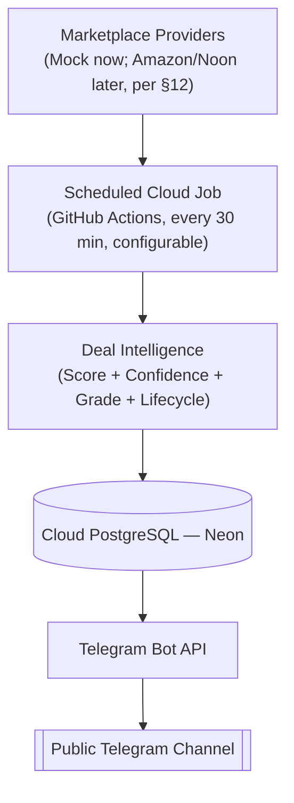

# Saudi Deal Intelligence Platform — Revised Cloud Architecture (Phase 0, v3)

**Status:** Awaiting approval before Phase 1. This revises the prior draft per your 20-point review. Every infrastructure number below (scan frequency, Neon compute budget, GitHub Actions constraints) is calculated from currently published limits, not assumed — the math is shown, not just the conclusion, per your "do not choose the frequency arbitrarily" instruction.

---

## 14. Confirmation: No Local Machine Required for Production

Stating this first since it's the hardest constraint. The production system after this revision consists of exactly:

- **GitHub Actions** (scheduled workflow) — an ephemeral cloud VM GitHub provisions per run and destroys after. Not your machine, not always-on, not anywhere you control the power switch.
- **Neon** (managed cloud Postgres) — cloud-hosted, reachable from anywhere.
- **Telegram Bot API** — Telegram's own cloud infrastructure.

APScheduler is removed from every production diagram below. It appears exactly once in this document, in §9, labeled explicitly as **local-development-only**, invoked by a developer running `python -m app.scheduler.dev_runner` on their own machine purely to test job logic without waiting for a cron tick — never deployed, never referenced by any GitHub Actions workflow, never part of the deployment target. You can shut your computer off and the production system is unaffected.

---

## 1 & 2. Updated Architecture Diagram + Cloud Deployment Diagram



The MVP (your instruction in §3: "A + B only") is the top `Cloud` subgraph alone. `FutureCloud` and `DevOnly` are drawn only to show they're structurally separate, not because they're needed yet.

---

## 3. Scheduled Scanning vs. Always-On Server — Resolved

Confirmed: **A (scanning) + B (channel publishing) require zero always-on server.** The GitHub Actions job is the entire MVP production system — it starts, does work, calls Telegram's HTTP API directly (`sendMessage`), and exits. Telegram's Bot API accepts `sendMessage` from any HTTP client with a valid bot token; nothing needs to be "running" to receive it.

**C (interactive bot)** — investigated per your instruction. Telegram supports two delivery modes:
- *Long-polling*: the bot process holds an open connection to Telegram, asking "any updates?" repeatedly — requires an always-on process.
- *Webhook*: Telegram POSTs each update to a URL you register once — the receiving process only needs to exist **at the moment a user sends a command**, which is exactly what a request-driven free tier (Render, sleeping when idle) supports. Telegram retries webhook delivery with backoff if the endpoint is briefly unreachable (e.g., mid-cold-start), so a sleeping receiver degrades to "slower first reply," not "dropped message."

So the interactive bot **does not require an always-running server**, confirming it's safe to defer to Phase 7 without redesigning anything now — the webhook receiver slots into the same Render service already planned for the admin dashboard (Phase 6).

**D (admin), E (click tracking), F (alerts)** — same request-driven Render service, all deferred per your phase list (§10).

---

## 4–8. Updated DEAL Model (Score, Confidence, Grade, Lifecycle, Freshness)

### DEAL table — expanded per your item 6

```text
DEAL
├── id                              PK
├── listing_id                      FK → MARKETPLACE_LISTING
├── deal_score                      int, 0-100
├── deal_confidence                 int, 0-100
├── deal_grade                      enum: A_PLUS | A | B | C | REJECT
├── deal_classification              enum: INSANE_DEAL | GREAT_DEAL | GOOD_DEAL | NORMAL | FLASH_DEAL | REJECT
├── score_breakdown                  json   — {factor_name: {contribution, reason_ar, reason_en}}
├── confidence_breakdown             json   — {factor_name: contribution}
├── discount_pct_advertised          decimal  — marketplace's own claim, never trusted for scoring
├── discount_pct_vs_avg30            decimal  — the number that actually feeds the score
├── discount_pct_vs_min              decimal
├── lifecycle_status                 enum: DISCOVERED | QUALIFIED | PUBLISHED | PRICE_CHANGED | EXPIRED | REJECTED | OUT_OF_STOCK | BLACKLISTED
├── freshness                        enum: FRESH | RECENT | STALE   — computed at render time from last_verified_at, not stored redundantly... 
│                                        (stored as a denormalized snapshot column ONLY on PUBLISHED_DEAL, where "what we told users" must be auditable after the fact; DEAL itself computes it live)
├── rejection_reason                 string, nullable
├── first_qualified_at               datetime, nullable  — first time lifecycle reached QUALIFIED
├── last_evaluated_at                datetime            — every scoring run touches this
├── last_verified_at                 datetime            — timestamp of the price observation the current score is based on
├── published_at                     datetime, nullable
└── expired_at                       datetime, nullable
```

Kept normalized per your instruction: `score_breakdown`/`confidence_breakdown` are JSON *because* their shape is inherently variable (factor set is config-driven — adding a factor shouldn't require a migration), not because I'm avoiding proper columns for things that *are* fixed-shape (those got real columns: `deal_score`, `deal_confidence`, `deal_grade`, all four lifecycle timestamps).

### Deal Confidence — separately calculated, per item 4

```text
DealConfidence = clamp(0, 100,
      W_obs_count    * f(number of PRICE_HISTORY rows for this listing)
    + W_history_age  * f(days between first_seen_at and now)
    + W_consistency  * f(price stddev / mean — lower variance = higher confidence)
    + W_provider_rel * f(this provider's recent error/timeout rate)
    + W_seller_cons  * f(has the seller changed on this listing recently — seller churn lowers confidence)
    + W_missing_data * f(how many optional fields — rating, review_count, seller_rating — are present)
)
```

This directly reproduces your example: a listing seen twice in one day scores near-zero on `W_obs_count`/`W_history_age` regardless of how good `deal_score` looks, so `Score: 94, Confidence: 35` and `Score: 94, Confidence: 94` are genuinely different code paths, not the same number relabeled.

### Deal Grade — derived from Score, gated by Confidence

```text
letter = threshold_lookup(deal_score)   # A+/A/B/C/REJECT, thresholds in config, not hardcoded
if deal_confidence < MIN_CONFIDENCE_FOR_GRADE:      # env-configurable
    letter = downgrade_one_level(letter)
deal_grade = letter
```

### Lifecycle — explicit state machine, idempotent by construction

```text
DISCOVERED → QUALIFIED → PUBLISHED → PRICE_CHANGED → EXPIRED
                 ↘ REJECTED          ↘ OUT_OF_STOCK
                                      ↘ BLACKLISTED (from any state, admin override)
```

Implemented as a `{current_state: {allowed_next_states}}` table in `deals/lifecycle.py`. Idempotency (your item 8) comes from two things working together: (a) transitioning to a state you're already in is a no-op, not an error — re-running the same scan twice against unchanged data leaves `lifecycle_status` exactly where it was; (b) the *trigger* for `PUBLISHED → PRICE_CHANGED` is a comparison against the price already stored on the last `PUBLISHED_DEAL`, not against "did something change since last run" — so a duplicate/replayed job run computes the same comparison and reaches the same conclusion, rather than double-flagging a change.

### Telegram deal expiration — item 9

`PRICE_CHANGED` and `EXPIRED` transitions call `telegram/publisher.py:update_or_expire()`, which calls Telegram's `editMessageText` on the *existing* `PUBLISHED_DEAL.telegram_message_id` — the post is edited in place (price updated, or an "⚠️ العرض منتهي" banner added), never left showing a stale price, and never republished as a new message (which would defeat dedup).

### "Why is this a deal?" — item 10, unchanged from prior draft's design

Each entry in `score_breakdown` already carries `{contribution, reason_ar, reason_en}`. The renderer lists entries whose `contribution` clears a "material" threshold, sorted descending — the explanation is read directly off the same numbers that produced the score, so it cannot contradict it, and needs no AI call.

---

## 11. Canonical Product Model — confirmed, `PRODUCT_MATCH` retired

Kept the `CANONICAL_PRODUCT` / `MARKETPLACE_LISTING` split introduced in the previous revision (not the flat `PRODUCT_MATCH` self-join from the original draft). Reasoning, since you asked for an explicit justification:

- `PRODUCT_MATCH` as a self-referencing table works, but it means "this Amazon row and this Noon row are the same product" is expressed as a *relationship between two rows that don't otherwise know they're the same thing* — every query that wants "the product" has to first resolve the match graph.
- `CANONICAL_PRODUCT` makes "the product" a first-class row. `MARKETPLACE_LISTING.canonical_product_id` is a plain foreign key. `PRICE_ALERT.canonical_product_id` means "notify me about this product, whichever marketplace it's cheapest on" is a direct join, not a graph traversal.
- Marketplace-specific price/seller/stock/URL/history all stay on `MARKETPLACE_LISTING` and `PRICE_HISTORY` (which references the listing, not the canonical product) — so nothing marketplace-specific is lost or merged away.

This is the same model as the prior revision; restated here because your review explicitly asked me to re-justify it rather than assume approval carried over.

---

## 12. Noon Remains First-Class — restated

`MockNoonProvider` and the `NoonProvider` interface remain fully specified in Phase 1/5, symmetric with Amazon's. The documented blocker is unchanged and is a business/compliance fact, not an engineering shortcut: no public product/price data API exists for Noon (verified in the prior revision's research) — only affiliate **link generation** through third-party networks. `NoonProvider.get_deals()`/`search_products()` are real methods with a real signature; their production implementation is blocked on you choosing a data-sourcing approach (§8 of the prior doc), not on missing code.

---

## 13. Scan Frequency — calculated, not guessed

Two independent constraints govern this, and I calculated against both rather than picking a round number.

**Constraint A — GitHub Actions scheduling mechanics:**
GitHub enforces a hard 5-minute minimum interval on cron triggers (anything more frequent is silently dropped, not errored), and explicitly warns that scheduled runs "can be delayed during periods of high load," with delays of 5–30 minutes being common. A 15-minute cadence has very little slack against a 5–30 minute delay before runs start bunching or getting skipped; a 30-minute cadence has comfortable slack. Separately, GitHub auto-disables a schedule after 60 days with no commit to the default branch — not a frequency constraint, but a reason to add a trivial keepalive step regardless of chosen frequency (mitigation, not blocker).

**Constraint B — Neon's 100 CU-hour/month free budget (this is the binding constraint):**
Neon's smallest compute (0.25 CU) suspends after 5 minutes of connection idle. Each *isolated* job run therefore costs roughly (actual DB work time + up to a 5-minute idle tail before suspend) × 0.25 CU, because runs spaced further apart than 5 minutes each pay their own suspend tail independently:

```text
Assume ~2 minutes of actual DB read/write work per scan run.
Per isolated run ≈ (2 min work + 5 min idle tail) / 60 × 0.25 CU ≈ 0.029 CU-hours

15-minute cadence: 96 runs/day × 30 days = 2,880 runs/month → ≈ 84 CU-hours/month
                    (16% headroom under the 100 CU-hour cap — too tight given this is an estimate)

20-minute cadence: 72 runs/day × 30 days = 2,160 runs/month → ≈ 63 CU-hours/month
                    (37% headroom)

30-minute cadence: 48 runs/day × 30 days = 1,440 runs/month → ≈ 42 CU-hours/month
                    (58% headroom — comfortable even if actual work time is 2-3x my estimate)
```

**Recommendation:** start at **30 minutes** (`SCAN_FREQUENCY_MINUTES=30`, fully configurable). This is the frequency that has real headroom against an *estimate* — I don't have production telemetry yet to know actual per-run DB-active time. Once Phase 4 is deployed, Neon's dashboard shows actual CU-hour consumption per run directly; if real usage comes in well under the 30-minute budget (likely, since 2 minutes of DB work is a conservative guess for a mock/small-catalog run), tightening to 20 or 15 minutes becomes a one-line config change backed by real data instead of a second guess. This is deliberately the "recommend a safe initial frequency, make it configurable, revisit with data" approach rather than committing to 15 minutes now and finding out mid-month that the database suspended for budget exhaustion.

---

## 15. Production Architecture Diagram (your requested exact shape)



No local machine. No always-on personal device. No paid infrastructure — confirmed component-by-component in §16.

---

## 16. Cloud Provider Evaluation (updated)

| Category | Selected | Free limits | Sleep/suspend behavior | Card required? | Auto-billing risk | Suitability |
|---|---|---|---|---|---|---|
| **Scheduler** | GitHub Actions | Unlimited on public repos, no minute cap | N/A (ephemeral, runs and exits) | No | None — no metered dimension on public repos | Selected |
| — considered | Cloudflare Cron Triggers | 100k req/day, but only 10ms CPU/invocation | N/A | No | None | Rejected — 10ms CPU can't run the pipeline; JS/Wasm-first, fights Python choice |
| **Database** | Neon (Postgres) | 100 CU-hours/mo, 0.5 GB storage, up to 2 CU autoscale | Scale-to-zero after 5 min idle, **auto-resumes on next connection, no manual step** | No | None documented — usage past cap suspends compute until next billing cycle, doesn't bill a card that doesn't exist | Selected |
| — considered | Supabase | 500 MB DB, 1 GB storage, 50k MAU | Pauses after 7 days *inactivity*, **manual dashboard-only unpause, no API** | No | None, but operational risk (manual recovery) | Rejected as primary — kept as documented fallback |
| **Serverless API / future bot** | Render free web service | 512 MB RAM, 0.1 CPU, 750 instance-hrs/mo | Sleeps after 15 min idle, 30–50s cold start | No | None documented | Selected, deferred to Phase 6/7 |
| — considered | Cloudflare Workers | 100k req/day, 10ms CPU (free) | N/A | No | None | Rejected for the same reason as scheduler — 10ms CPU too tight for a Python FastAPI-style handler; would require a full rewrite to JS/Wasm for a component this project doesn't need until Phase 6+ |
| — considered | Supabase Edge Functions | Bundled with Supabase | N/A | No | None | Not selected — would mean adopting Supabase (with its pause behavior) just to get this, when the primary DB choice is already Neon |

---

## 17. Zero-Cost Requirement — how unexpected charges are specifically prevented

Not just "these have free tiers" — the specific mechanism that prevents a surprise bill on each:

- **GitHub Actions**: public-repo runners have no metered dimension to exceed. `timeout-minutes` on the workflow additionally caps any single run regardless.
- **Neon**: no credit card on file on the Free plan. Exceeding the 100 CU-hour/month budget suspends the project's compute until the next billing cycle rather than billing anything — there is nothing to bill.
- **Render**: no credit card on file on the free web service tier. No documented auto-upgrade path exists without you explicitly adding a payment method and picking a paid plan.
- **The one real risk** is not "hidden charges" but "the free tier's terms change" — which is exactly what happened to Fly.io and Railway in the last two years. Mitigation: nothing here is deeply vendor-coupled (plain GitHub Actions YAML, plain SQLAlchemy against standard Postgres, plain FastAPI), so a forced migration is a redeploy, not a rewrite. `DEPLOYMENT.md` will name the fallback for each tier (Turso/Supabase for DB, any Python-supporting free PaaS for the web service).

---

## 9. Updated Scheduler Architecture

```text
Production:  .github/workflows/scheduled-scan.yml
             --schedule: cron '*/30 * * * *' (configurable)
             --concurrency group prevents overlapping runs
             --timeout-minutes caps runaway jobs
             --calls: python -m app.scheduler.runner   (the ONLY production entrypoint)

Development only (never deployed):
             python -m app.scheduler.dev_runner
             --wraps the same job functions in APScheduler purely so a developer
               can watch the pipeline run repeatedly without waiting on a real cron tick
               or spending GitHub Actions minutes while iterating locally
             --imports nothing that isn't also imported by runner.py — there is exactly
               one implementation of the job logic; dev_runner and the Actions workflow
               are two different callers of the same functions, not two implementations
```

---

## 10. Updated Development Phases (adopting your exact renumbering)

- **Phase 0** — Cloud architecture and infrastructure verification *(this document)*
- **Phase 1** — Foundation + database (MVP scope only, §14 below) + mock providers
- **Phase 2** — Deal Intelligence (normalization, canonical matching, price history, Score/Confidence/Grade, lifecycle, dedup)
- **Phase 3** — Telegram Channel (formatter, publisher, publishing history, price-change/expiration edits)
- **Phase 4** — Cloud Deployment (GitHub Actions + Neon live; public channel goes live on mock data if real credentials aren't ready yet, or real data if they are)
- **Phase 5** — Real Amazon/Noon providers (per §12's documented blockers)
- **Phase 6** — Admin (Render service stood up here — first thing that actually needs it)
- **Phase 7** — Interactive Telegram Bot (webhook mode, same Render service)
- **Phase 8** — Alerts / personalization / analytics
- **Phase 9** — Advanced intelligence (trending, prediction, semantic matching, AI-assisted copy — optional provider, never required)

---

## 14. MVP Database Scope for Phase 1

Per your instruction, Phase 1 implements only:

```text
MARKETPLACE
CANONICAL_PRODUCT        (your "Product" concept, split for the reasons in §11)
MARKETPLACE_LISTING      (the marketplace-specific half of "Product")
SELLER
CATEGORY
PRICE_HISTORY
DEAL                      (full expanded shape from §4-8 — the fields aren't optional,
                            they're what makes Score/Confidence/Grade/lifecycle work at all,
                            so this table is exempt from deferral even though it's "new")
PUBLISHED_DEAL
```

Deferred to their respective later phases: `USER`, `USER_PREFERENCE`, `PRICE_ALERT` (Phase 8), `CLICK_EVENT` (Phase 8), `ADMIN_USER`, `AUDIT_LOG` (Phase 6). Alembic migrations for Phase 1 create only the eight tables above — the later tables get their own migrations when their phase starts, not speculative empty tables now.

---

## 11 (project directory). Updated Project Directory

```text
app/
├── main.py                       # not used in Phase 1-5; exists from Phase 6 (Render entrypoint)
├── core/                           # config, logging, timezone, exceptions
├── db/                              # SQLAlchemy models (8 Phase-1 tables), Alembic, repositories
├── domain/                           # DTOs, enums (LifecycleStatus, DealGrade, Freshness...)
├── providers/{base.py, amazon/, noon/}
├── matching/                          # canonical product resolution
├── pricing/                            # price history + rolling stats
├── scoring/                             # score.py, confidence.py, grade.py, explanation.py
├── deals/                                # pipeline.py, lifecycle.py, dedup.py
├── telegram/{formatter.py, publisher.py}    # Phase 3; bot/ subpackage added Phase 7
├── scheduler/{runner.py, dev_runner.py}      # runner.py = production; dev_runner.py = local-only
└── services/di.py

# Added starting Phase 6:
├── admin/, api/, telegram/bot/

tests/{unit,integration,e2e,fixtures}/
.github/workflows/{ci.yml, scheduled-scan.yml, security.yml}
alembic.ini, pyproject.toml, .env.example
README.md / ARCHITECTURE.md / DEVELOPMENT.md / DEPLOYMENT.md / SECURITY.md / CONTRIBUTING.md
```

Docker/docker-compose exist for local dev parity only, unchanged from prior drafts, never required for production.

---

## 12 (risks). Updated Risks

| Risk | Mitigation |
|---|---|
| 30-min scan feels slow for a "deals channel" | Deliberately conservative starting point backed by real Neon telemetry once live (§13) — tightening is a config change, not a redesign |
| Neon CU-hour estimate is wrong | Neon's dashboard shows actual per-run consumption from day one of Phase 4; §13's math is a pre-launch estimate, explicitly flagged as such |
| GitHub Actions schedule delay during high load | 30-min cadence chosen partly for slack against documented 5–30 min delays; a canary/alert (a separate lightweight check that a run happened in the last N minutes) can be added in Phase 8 if reliability needs tightening |
| 60-day inactivity auto-disable | A trivial keepalive step (or simply ongoing development commits, which this project will have) resets the clock; documented in `DEPLOYMENT.md` |
| Amazon Associates approval delayed/denied | Phases 1–4 work fully on mocks; channel can go live on mock or real data independently |
| No official Noon data source | Documented blocker (§12), decision point before Phase 5 touches it |
| Render cold start (Phase 6+) | Disclosed tradeoff, acceptable at MVP admin/bot traffic levels |
| Free-tier terms shift industry-wide | No vendor lock-in beyond plain GitHub Actions/Postgres/FastAPI; documented fallback per component |

---

## 13 (prerequisites/accounts). Exact Prerequisites/Accounts

**Software:** Python 3.12+, `pip`/`venv` or `uv`, Git, Docker (optional, dev-only).
**Accounts, in the order Phase 1–7 actually needs them:**
1. GitHub (public repo) — Phase 1
2. Neon (no card) — Phase 1
3. Telegram bot token + channel — Phase 3
4. Render (no card) — Phase 6
5. Amazon Associates (`.sa`) — only if/when you pursue Phase 5 real Amazon data
6. A Noon-side affiliate network — only once you've resolved the Noon data-sourcing decision (§12)

---

This is the complete revised Phase 0 deliverable. No implementation code has been written. Waiting for your approval before Phase 1.
